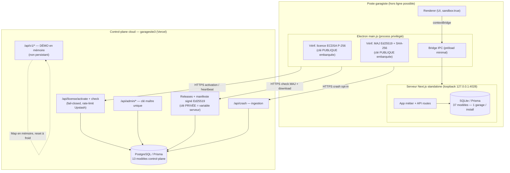

# Vue d'ensemble de l'architecture — Écosystème GarageFlow

> Document de data room — diligence technique M&A. Rédigé à des fins factuelles.
> Statut de maturité : voir la légende de chaque composant. Toute capacité non
> construite est signalée explicitement (« NON CONSTRUIT / roadmap »).

## 1. Périmètre de l'écosystème

GarageFlow est un logiciel de gestion d'atelier automobile mono-garage, livré
sous trois surfaces techniques distinctes qui partagent une large base de code :

| Surface | Dépôt | Stack | Rôle |
|---|---|---|---|
| **Application desktop** | `/home/user/GarageFlowsV2` | Electron 31 + Next.js 14 (standalone) + SQLite/Prisma | Produit métier principal, installé chez le garagiste (Windows x64) |
| **PWA** | `/home/user/GarageFlowsV2` (même code Next.js) | Next.js 14 + Prisma (PostgreSQL en mode hébergé) | Même application web, servie hors coquille Electron |
| **Control-plane cloud** | `/home/user/garagesite3` | Next.js 15 (App Router) + PostgreSQL/Prisma + Vercel | Vitrine marketing + backend de licences / mises à jour / crash / audit |

Légende de statut employée dans ce document : **Opérationnel** (câblé et
fonctionnel) · **Partiel** · **Code seul, sans UI** · **NON CONSTRUIT (roadmap)**.

## 2. Les trois composants

### 2.1 Application desktop (produit métier)
- Coquille Electron (`electron/main.js`, ~102 Ko) qui démarre un serveur Next.js
  **standalone** en boucle locale sur `127.0.0.1:4028` (`electron/main.js:82`,
  `1547`), jamais exposé au LAN.
- Persistance **SQLite** via Prisma, **37 modèles** métier
  (`prisma/schema.prisma`), base amorcée depuis un template livré au premier
  démarrage, sauvegardes horaires/quotidiennes/hebdomadaires.
- Isolation renderer stricte (`contextIsolation`, `sandbox`, préload minimal).
- Voir `docs/DESKTOP_ARCHITECTURE.md` pour le détail.

### 2.2 PWA (code partagé)
- Le **même** applicatif Next.js que le desktop, servi comme application web
  installable. En mode hébergé, le provider Prisma cible PostgreSQL
  (`prisma/server/schema.prisma`, miroir à 37 modèles, quasi identique au
  schéma desktop — seuls provider / `directUrl` / commentaires diffèrent).
- Couverture de test PWA mince (`src/lib/__tests__/pwa.test.ts`, ~72 lignes) :
  pas de validation E2E service-worker / offline. **Partiel.**

### 2.3 Control-plane cloud (garagesite3)
- Backend de licences / devices / releases / modules / crash / audit, adossé à
  PostgreSQL, **13 modèles** (`garagesite3/prisma/schema.prisma`), déployable
  sur Vercel. **135 tests unitaires** verts (hors intégration).
- Contient aussi une vitrine marketing et une **API publique `/api/v1`** qui est
  une **démo en mémoire non persistante** (voir §5). 
- Voir `docs/CLOUD_ARCHITECTURE.md` pour le détail.

## 3. Frontières de données et de confiance

**Frontières de confiance clés :**
1. **Renderer → main Electron** : uniquement via `contextBridge`, aucun accès
   Node brut (`electron/preload.js`). Le renderer est non privilégié.
2. **Main Electron → serveur loopback** : le serveur Next.js n'écoute que sur
   `127.0.0.1` ; les endpoints internes (`/api/internal/*`) sont protégés par une
   clé aléatoire par exécution.
3. **Poste → cloud** : HTTPS uniquement, hosts de téléchargement en liste
   blanche (`api.garageflows.fr`, `garageflows.fr`, `app.garageflows.fr` —
   `electron/update-verify.js`). La confiance repose sur des **clés publiques
   embarquées** ; les clés **privées** correspondantes restent côté serveur.
4. **Données métier vs control-plane** : les données métier (factures, devis,
   clients…) vivent **exclusivement** sur le poste (SQLite). Le cloud ne stocke
   **aucune** donnée métier — seulement licences, devices, releases, crash,
   audit, leads/newsletter.

## 4. Interactions entre composants

| Flux | Émetteur → récepteur | Mécanisme | Statut |
|---|---|---|---|
| **Activation de licence** | Desktop → `/api/license/activate` | Token ECDSA P-256 (`GF2.*`) vérifié par clé publique embarquée ; siège atomique `SELECT … FOR UPDATE` | Opérationnel |
| **Heartbeat / device auth** | Desktop → `/api/license/check` | Token device HMAC signé ; poll adaptatif (2 min / 20 s si bloqué) ; **fail-open** en cas d'erreur réseau | Opérationnel |
| **Mises à jour** | Desktop ← control-plane | Manifeste **Ed25519** obligatoire (si clé embarquée), SHA-256 vérifié **avant** exécution, anti-downgrade | Opérationnel (code) — dépend du backend qui sert les manifestes signés |
| **Rollback automatique sur crash** | Control-plane (interne) | `autoRollbackIfUnhealthy` + endpoint `rollback-check` | **Code seul** — pas de cron Vercel câblé d'origine ; un Vercel Cron fail-closed a été ajouté cette session |
| **Crash reporting** | Desktop → `/api/crash` | Opt-in (défaut OFF, RGPD), rédaction des secrets, file d'attente offline | Opérationnel |
| **Modules / entitlements** | Control-plane → Desktop | `computeEffectiveModules`, renvoyés dans les réponses activate/check | Opérationnel |

## 5. Points d'attention structurels (à divulguer)

- **API publique `/api/v1` = démo en mémoire** : toutes les ressources
  (clients, véhicules, factures, devis, pièces…) sont adossées à une `Map` en
  mémoire réamorcée à chaque démarrage, **explicitement non persistante**
  (`garagesite3/src/lib/api/store.ts:1-8`). Sur Vercel serverless, les écritures
  sont perdues à chaque cold start et non partagées entre instances. **Ce n'est
  pas une surface d'intégration de production.**
- **Pas de e-facturation** : aucun code Factur-X / UBL / CII / Chorus Pro / PDP
  / e-reporting dans l'écosystème. **NON CONSTRUIT.**
- **Pas d'assistant d'import CSV/Excel** : aucune dépendance de parsing
  (papaparse/xlsx/exceljs absentes), aucune UI/route d'import. **NON CONSTRUIT.**
- **Pas de tests E2E** : aucun Playwright/Cypress ; toute la couche UI des trois
  surfaces est validée manuellement. **NON CONSTRUIT.**
- **Pas de hiérarchie organisation / multi-garage** : le schéma culmine à
  l'entité `Garage`. Le « réseau multi-garage » est une capacité de
  licensing/déploiement + un palier tarifaire marketing, **pas** une hiérarchie
  organisationnelle opérationnelle. **NON CONSTRUIT.**
- **Actifs P0 hors dépôt** : l'opérabilité dépend de transferts d'actifs
  **externes au code** — les deux clés privées de signature (licence P-256 +
  MAJ Ed25519), le backend/base de données en fonctionnement, les domaines
  `garageflows.fr`, et une cession de PI écrite. Ce sont des conditions de
  closing, pas des livrables de code.

## 6. Chiffres vérifiés (session 2026-07-31)

| Indicateur | Desktop (GarageFlowsV2) | Cloud (garagesite3) |
|---|---|---|
| Modèles Prisma | 37 (+ 37 miroir serveur) | 13 |
| Routes API (`route.ts`) | 125 | 56 |
| Tests (sous-ensemble hors intégration) | 678 passés / 0 échec | 140 passés / 0 échec |
| `tsc --noEmit` | exit 0 | exit 0 |

> Les suites complètes incluent en plus des tests d'intégration PostgreSQL/Redis
> exécutés en CI, non reproduits localement lors de cet audit.

---
*Réf. croisée : voir `docs/ACQUISITION_READINESS_AUDIT.md` pour la synthèse des risques classés et des scores de préparation.*
