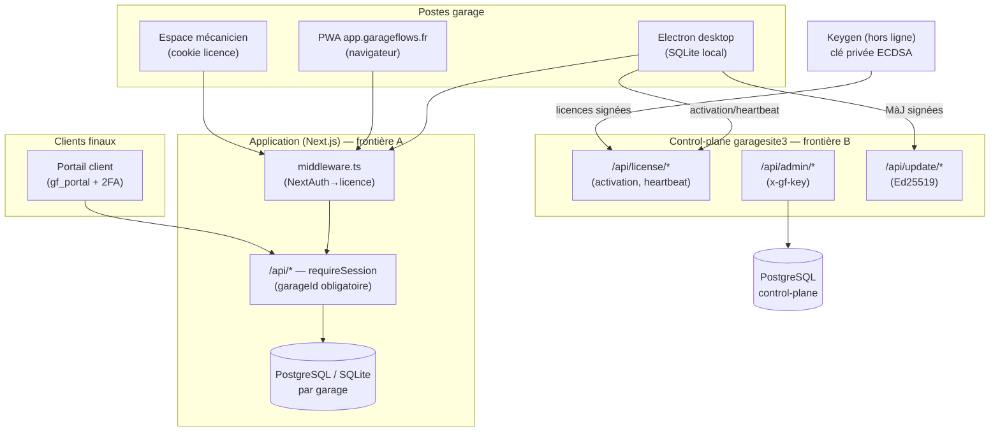

# Modèle de menaces — GarageFlows (lot B)

> Modèle de menaces STRIDE par frontière de confiance, dérivé du code réel des
> deux dépôts. Objet : due diligence sécurité — recenser les actifs, les
> frontières, les menaces et les contre-mesures EN PLACE (avec preuve
> `fichier`/test) vs RÉSIDUELLES (→ `RISK_REGISTER.md`). Complète
> `docs/SECURITY.md` et `docs/SECURITY-HARDENING.md`.

## 1. Actifs à protéger

| Actif | Où | Sensibilité |
|---|---|---|
| Données clients finaux (PII, véhicules) | app, par garage | RGPD |
| Documents comptables (factures, FEC) | app | légal (immuabilité, séquence) |
| Secrets d'auth/session | env | critique |
| Clé privée de signature de licence | env serveur uniquement | critique |
| Jetons de licence / d'appareil | control-plane | élevé |
| Mots de passe (staff, portail) | app (bcrypt) | élevé |
| Secrets 2FA TOTP / SMTP | app (chiffrés AES-256-GCM) | élevé |
| Sauvegardes | userData (chiffrées) | élevé |

## 2. Architecture & frontières de confiance

**Frontières de confiance** : (A) navigateur/desktop → application ; (B) client
installé → control-plane ; (C) application ↔ base de données (scoping garageId) ;
(D) processus de rendu Electron ↔ processus principal (preload/IPC) ; (E) keygen
hors-ligne → serveur (signature asymétrique, clé privée jamais en ligne).

## 3. STRIDE par frontière

### Frontière A — Application (routes `/api/*`)

| Menace | Vecteur | Contre-mesure en place | Preuve | Résiduel |
|---|---|---|---|---|
| **S**poofing | session forgée | NextAuth + `validateLicensedSession` ; cookies signés (jose) | `require-session-enforcement.test.ts` | — |
| **T**ampering | doc légal altéré | machine à états immuable (facture/OR/devis) | `document-immutability.test.ts` | — (AUD-001/002/004 corrigés) |
| **R**epudiation | action niée | `AuditLog` acteur/cible | `mechanic-admin.test.ts` | rétention à définir |
| **I**nfo disclosure | fuite inter-garage | scoping garageId sur 141 routes | audit 0 faille + `tenant-isolation-matrix.test.ts` | portail/mécano peu testés (AUD-022) |
| **D**oS | flood | rate-limit (`api`) | `security-rate-limit.test.ts` | — |
| **E**levation | rôle outrepassé | `can()` deny-by-default, 128 cellules | `authz-full-matrix.test.ts` | session JWT non invalidable ≤30j (AUD-033) |

### Frontière B — Control-plane (garagesite3)

| Menace | Contre-mesure | Preuve | Résiduel |
|---|---|---|---|
| Spoofing licence | vérif ECDSA P-256 (clé publique embarquée) | `verify.ts`, `public-key-consistency.test.ts` | licences HMAC héritées forgeables (AUD-007) |
| DoS distribué | limiteur **fail-closed** (Upstash) | `rate-guard.test.ts` | — (AUD-009 corrigé) |
| Elevation admin | `guardAdmin` (x-gf-key constant-time) | — | clé unique statique (AUD-010), tests requireAdminKey absents (AUD-018) |
| Info disclosure | notifications par licenseId | — | pas de preuve d'appareil (AUD-011) |
| Tampering MàJ | manifeste signé Ed25519 | `manifest.test.ts` | — |

### Frontière C — Base de données (multi-tenant)

Scoping `garageId` dans chaque `where` (lecture/écriture/suppression) + validation
des FK (`assertRelations`) avant usage + écritures atomiques `updateMany/deleteMany`.
Audit statique 141 routes : 0 faille. **Résiduel** : aucun.

### Frontière D — Electron (renderer ↔ main)

`contextIsolation`, `sandbox`, Fuses (RunAsNode off, `OnlyLoadAppFromAsar`),
garde de navigation (`localOrigin` — **AUD-003 corrigé**), preload minimal,
`will-attach-webview` refusé, écoute loopback exclusive. **Résiduel** : installeur
non signé Authenticode (AUD-008).

### Frontière E — Keygen / signature

Clé privée ECDSA **hors ligne**, jamais dans un dépôt ni un serveur web ; seule
la clé publique est embarquée (empreinte gardée par `check-critical-files.js`).
**Résiduel** : décision de cohérence de paire ECDSA en production (AUD-007) ;
la garde `check-critical-files.js` n'est pas câblée en CI (AUD-029).

## 4. Menaces transverses

- **Secrets dans l'historique git** (AUD-005/006) : rotation = vrai correctif ;
  mécanisme de preuve livré (`verify:rotation`). Purge d'historique = propriétaire.
- **XSS** (AUD-024) : CSP présente mais `script-src 'unsafe-inline'/'unsafe-eval'`
  neutralise la défense principale ; à durcir par nonce.
- **Supply chain** : SBOM livré (0 copyleft fort) ; installeur non signé, gitleaks
  durci (AUD-032 corrigé).

## 5. Synthèse

Les menaces des frontières A et C (spoofing session, tampering documents, fuite
inter-garage, élévation de rôle) disposent de contre-mesures **prouvées par
test**. Les résiduels se concentrent sur la frontière B (control-plane : clé
admin, preuve d'appareil) et sur des actions externes (rotation, signature
installeur, revue juridique) — tous tracés dans `RISK_REGISTER.md` avec responsable.
